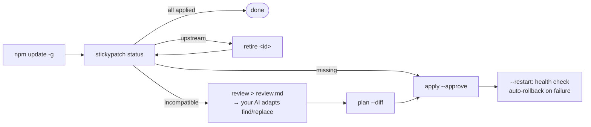

<div align="center">

# stickypatch

**Local patches for globally installed npm CLIs that survive `npm update -g`,<br/>and tell you when upstream fixed the bug.**

[](https://github.com/tone-leh/stickypatch/actions/workflows/ci.yml)


[](LICENSE)

English · [简体中文](README.zh-CN.md)


</div>

You fixed something in a CLI you use every day, like Codex, Claude Code, a local LLM proxy or any
`npm i -g` tool, by editing its installed source. Then it auto-updated and **your fix silently
vanished.** Sometimes it's worse: the code moved, a half-remembered fix gets re-applied in the wrong
place, and you spend an evening debugging your own patch.

`patch-package`, `pnpm patch` and `bun patch` are built for your **project's** dependencies. They
don't follow global installs across fnm / nvm / Volta / Homebrew, and when upstream refactors the
file all they can say is "failed". **stickypatch** is built for the tools you *run*:

- **Capture, don't hand-write.** Edit the installed file, then run `stickypatch capture`. It diffs
  against a pristine copy and builds the smallest **unique** anchors for you.
- **Honest statuses.** Each patch is `applied`, `missing`, `outdated`, `upstream`,
  `incompatible`, `unverifiable` or `retired`. Nothing gets lumped into a vague "ok".
- **Knows when to quit.** Give a patch an `upstream` marker. When the new version ships the fix,
  stickypatch tells you to **retire** the patch instead of re-applying it.
- **AI-ready review.** `stickypatch review` writes a Markdown brief for Claude / Codex / ChatGPT:
  what each patch expected, the closest code in the new version, and how to decide
  **retire / keep / adapt**.
- **Never half-applies.** Every batch is rendered in memory first. Each file's hash is checked
  again right before it is written, every batch is backed up, and rollback restores the exact bytes.
- **Restart, health check, auto-rollback.** `apply --restart` restarts your service and waits for
  `/healthz`. If the service doesn't come back healthy, the batch is undone.
- **Agent-safe.** `guard.denyEnv` stops an AI agent from patching and restarting the proxy its own
  requests run through. See [the story](#why-this-exists).
- Zero dependencies, Node 18+, macOS and Linux.

## Quick start

```bash
npm i -g github:tone-leh/stickypatch

stickypatch init @openai/codex           # finds the copy that `codex` on your PATH actually runs
# …edit a file inside that package, then:
stickypatch capture "$(npm root -g)/@openai/codex/<file you edited>" --id my-fix --why "what it fixes"

# after every update:
stickypatch status                       # exit 1 if anything needs attention
stickypatch apply                        # atomic, backed up, reversible
```

**Try it without touching anything real.** This 60-second tour runs in a temp dir:

```bash
git clone https://github.com/tone-leh/stickypatch && bash stickypatch/examples/demo/try.sh
```

## The update loop



| Status | Meaning | What to do |
| --- | --- | --- |
| ✔ `applied` | Present and complete | Nothing |
| ● `missing` | Gone (usually after an update), anchors intact | `stickypatch apply` |
| ↻ `outdated` | An older form of your patch is present | `apply` migrates it |
| ★ `upstream` | Your `upstream` markers matched: the fix is built in | `stickypatch retire <id>` |
| ✖ `incompatible` | Anchor moved, became ambiguous, or clashes | `stickypatch review` → adapt |
| ? `unverifiable` | A target file no longer exists | `stickypatch review` |
| – `retired` | You retired it. Kept as a record, never applied | Nothing |

New versions are **untested** until you say otherwise. `apply` refuses them until you run
`stickypatch approve`, or `apply --approve`. An anchor that still matches is not proof the
patch still *means* the same thing, so take a look first.

## Config

`stickypatch init` writes `stickypatch.json` in the current folder (or
`~/.config/stickypatch/stickypatch.json` with `--global`). A patch is a list of exact
`find` → `replace` edits (the values below are illustrative):

```jsonc
{
  "$schema": "https://raw.githubusercontent.com/tone-leh/stickypatch/main/stickypatch.schema.json",
  "package": "@bitkyc08/opencodex",          // or "path": "/abs/dir" for anything with a package.json
  "bin": "ocx",                             // command used to find the copy that really runs
  "testedVersions": ["2.88.0"],
  "restart": "ocx service restart",         // used by --restart
  "health": "http://127.0.0.1:10100/readyz",
  "busy": "my-check-no-active-sessions",    // exit 0 = safe to restart
  "guard": { "denyEnv": ["CODEX_THREAD_ID"] },
  "patches": [
    {
      "id": "long-history-replay",
      "why": "Long conversations were rejected as 'not replayable' and every reset became a 429.",
      "edits": [
        {
          "file": "src/server/responses/reset-replay.ts",
          "find": "const MAX_SCAN = 4096;",           // must occur exactly once
          "replace": "const MAX_SCAN = 200_000;",
          "previous": ["const MAX_SCAN = 50_000;"]    // older forms -> status "outdated"
        }
      ],
      "upstream": [                                 // evidence that upstream fixed it
        { "file": "src/server/responses/reset-replay.ts", "contains": "MAX_REPLAY_SCAN_NODES" }
      ]
    }
  ]
}
```

- `find` / `replace` take a string, an array of lines, or `{ "file": "patches/x.txt" }`.
- One config can hold several packages with `"targets": [ … ]`. Pick one with `-t <name>`.
- Need logic instead of text? Use `stickypatch.config.mjs` and give a patch `detect()` /
  `render()` functions ([example](examples/custom-patch.stickypatch.config.mjs)).
- Full schema: [`stickypatch.schema.json`](stickypatch.schema.json). Templates: [`examples/`](examples).

## Commands

| Command | What it does |
| --- | --- |
| `status` | Check every patch against the installed version. `--json` for scripts. Exit 1 = needs attention |
| `apply` | Apply missing/outdated patches as one batch. `--approve`, `--partial`, `--only a,b`, `--restart` |
| `plan [--diff]` | Show exactly what `apply` would write. Writes nothing |
| `review [-o file]` | Markdown brief for an AI agent or a human. `--all` includes healthy patches |
| `capture <file…> --id x` | Turn hand edits into a patch. Downloads a pristine copy via `npm pack` (or use `--pristine <dir>`) |
| `approve` | Mark the installed version as tested |
| `retire <id> [--reason]` | Stop maintaining a patch, keeping it as a record |
| `batches` / `rollback <id>` | List batches, restore one batch's exact bytes. Refuses if the files changed since |
| `init <package>` | Create or extend a config. `--global`, `--bin`, `--path` |

Exit codes: `0` ok · `1` needs attention / health check failed · `2` error · `3` refused (read-only guard, busy, not confirmed).

## Using it with AI agents

stickypatch splits the work: **agents prepare, humans apply.**

1. Your agent runs `stickypatch status --json` and `stickypatch review`, decides retire / keep /
   adapt for each patch, edits `stickypatch.json`, and proves it with `stickypatch plan --diff`.
2. It hands you **one** command, e.g. `stickypatch apply --approve --restart`, which you run in
   your own terminal.

Drop [`skills/stickypatch/SKILL.md`](skills/stickypatch/SKILL.md) into Claude Code
(`~/.claude/skills/`) or Codex (`~/.codex/skills/`) and the agent follows this loop on its own.
Set `guard.denyEnv` to an env var your agent sessions always have (run `env` inside one to
find it; Codex shells usually have `CODEX_THREAD_ID`), or export `STICKYPATCH_READONLY=1` there. Write commands then refuse inside the agent, and the
read-only ones still work.

## Check automatically after every global update

```bash
# ~/.zshrc or ~/.bashrc
npm() {
  command npm "$@"; local s=$?
  if [[ " $* " == *" -g "* || " $* " == *" --global "* ]]; then stickypatch status || true; fi
  return $s
}
```

## Why this exists

I run a local LLM proxy ([opencodex](https://github.com/lidge-jun/opencodex)) with a handful of
local fixes. It often ships several releases a week, and every update wiped my fixes. I let AI
agents re-apply them, and things got worse in two ways. First, an anchor that "still matched"
was sometimes applied to code that now meant something else. Second, the agent doing the
maintenance talked to its model *through that proxy*, so restarting the proxy cut off the agent
in the middle of the change.

The script that grew out of this (atomic batches, exact rollback, "upstream fixed it, retire
the patch", review-before-apply, never restart from inside the session) became stickypatch.
The retire step turned out to be the most useful part, because most local patches should
eventually go away.

## FAQ

**Isn't this just monkey-patching?** Yes, made boring and safe. If you can, send the fix
upstream too, and add an `upstream` marker so stickypatch tells you when it lands.

**Why anchors instead of diffs?** A unified diff expects its context lines in the same place. An
exact, unique anchor survives code moving around it. When the anchor itself changes, you get
`incompatible` and the review shows the closest code. Nothing is applied somewhere it might
not belong.

**Which copy gets patched?** stickypatch follows the command on your `PATH` to the package that
actually runs, then tries `npm root -g`, then fnm / nvm / Volta / Homebrew / bun / pnpm layouts.
If it finds several copies and can't tell which one runs, it stops and asks you to set `path`.

**Where are backups?** `~/.stickypatch/batches/<target>/<batch-id>/`, with a manifest, the
original files and a log. Set `STICKYPATCH_HOME` or `batchDir` to move them.

## Contributing

Issues and PRs are welcome. Run `npm test`; it has zero dependencies and finishes in seconds.
See [CONTRIBUTING.md](CONTRIBUTING.md).

## License

[MIT](LICENSE)
