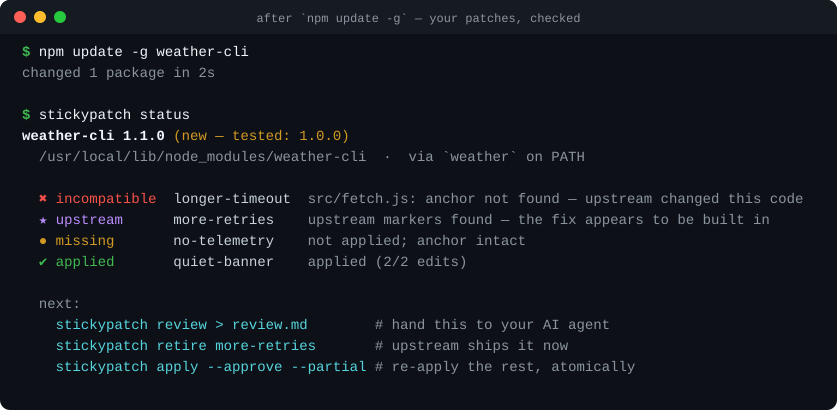
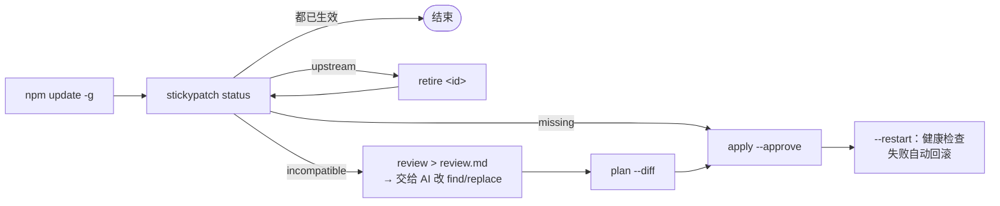

<div align="center">

# stickypatch

**给全局安装的 npm 命令行工具打本地补丁：`npm update -g` 之后补丁还在，<br/>上游修好了也会告诉你。**

[](https://github.com/tone-leh/stickypatch/actions/workflows/ci.yml)


[](LICENSE)

[English](README.md) · 简体中文



</div>

你天天在用某个命令行工具，比如 Codex、Claude Code、本地 LLM 代理，或者任何 `npm i -g` 装的工具。你改了它安装目录里的源码，修好了一个问题。然后它自动更新了，**你的修复悄悄没了。**
更糟的情况是代码换了位置，凭记忆把补丁又打了一遍，结果打错了地方，花一晚上排查自己的补丁。

`patch-package`、`pnpm patch`、`bun patch` 管的是**项目**依赖。fnm、nvm、Volta、Homebrew 底下的全局安装它们找不到；上游一重构，它们只会报“失败”。**stickypatch** 管的是你**每天在跑**的那些工具：

- **改完直接捕获，不用手写补丁。** 直接改安装目录里的文件，然后运行 `stickypatch capture`。它会和原版对比，自动生成最短且**唯一**的锚点。
- **状态说实话。** 每个补丁分别报告 `applied`、`missing`、`outdated`、`upstream`、`incompatible`、`unverifiable`、`retired`，不会混成一个笼统的“正常”。
- **知道什么时候该退场。** 给补丁写一个 `upstream` 标记。新版本自带这个修复时，stickypatch 会提示你**退役**这个补丁，而不是再打一遍。
- **给 AI 准备好审查材料。** `stickypatch review` 生成一份 Markdown，交给 Claude、Codex 或 ChatGPT 都能直接用。里面有每个补丁原本要找的代码、新版本里最相近的代码，以及判断**退役 / 保留 / 适配**的步骤。
- **不会只打一半。** 每批改动先在内存里生成。写入前再核对一遍文件哈希，每批都有备份，回滚能恢复到原来的字节。
- **重启、健康检查、失败自动回滚。** `apply --restart` 会重启你的服务并等 `/healthz` 正常。如果服务没能恢复正常，这批改动自动撤销。
- **防止 AI 代理把自己弄断。** 设置 `guard.denyEnv` 后，AI 代理就没法给自己请求所经过的代理打补丁、再把它重启。详见[由来](#由来)。
- 零依赖，Node 18+，支持 macOS 和 Linux。

## 快速开始

```bash
npm i -g github:tone-leh/stickypatch

stickypatch init @openai/codex           # 自动找到 PATH 上 `codex` 实际运行的那份安装
# ……改好包里的某个文件，然后：
stickypatch capture "$(npm root -g)/@openai/codex/<你改的文件>" --id my-fix --why "修了什么"

# 每次更新后：
stickypatch status                       # 有需要处理的就返回 1
stickypatch apply                        # 原子写入、有备份、可回滚
```

**不想碰真实环境？** 下面这段 60 秒演示全在临时目录里跑：

```bash
git clone https://github.com/tone-leh/stickypatch && bash stickypatch/examples/demo/try.sh
```

## 更新后的流程



| 状态 | 含义 | 怎么办 |
| --- | --- | --- |
| ✔ `applied` | 已生效且完整 | 不用管 |
| ● `missing` | 没了（通常是更新造成的），锚点还在 | `stickypatch apply` |
| ↻ `outdated` | 是补丁的旧版本 | `apply` 会自动迁移 |
| ★ `upstream` | `upstream` 标记命中，官方已经自带这个修复 | `stickypatch retire <id>` |
| ✖ `incompatible` | 锚点挪了位置、出现多处，或者和别的内容冲突 | `stickypatch review` → 适配 |
| ? `unverifiable` | 目标文件不存在了 | `stickypatch review` |
| – `retired` | 已退役，只留作记录，不再应用 | 不用管 |

新版本默认是**未验证**的。在你运行 `stickypatch approve`（或 `apply --approve`）之前，`apply` 会拒绝执行。锚点还能匹配，不代表补丁的意思没变，先看一眼。

## 配置

`stickypatch init` 会在当前目录生成 `stickypatch.json`；加 `--global` 则生成在 `~/.config/stickypatch/stickypatch.json`。一个补丁就是若干条精确的 `find` → `replace` 改动（下面的值只是示意）：

```jsonc
{
  "package": "@bitkyc08/opencodex",          // 或 "path": "/绝对路径"，任何带 package.json 的目录都行
  "bin": "ocx",                             // 用来找到实际运行的那份安装
  "testedVersions": ["2.88.0"],
  "restart": "ocx service restart",         // --restart 时执行
  "health": "http://127.0.0.1:10100/readyz",
  "busy": "my-check-no-active-sessions",    // 返回 0 表示现在可以重启
  "guard": { "denyEnv": ["CODEX_THREAD_ID"] },
  "patches": [
    {
      "id": "long-history-replay",
      "why": "长对话被判为不能重发，每次断线都变成 429。",
      "edits": [
        {
          "file": "src/server/responses/reset-replay.ts",
          "find": "const MAX_SCAN = 4096;",           // 必须恰好出现一次
          "replace": "const MAX_SCAN = 200_000;",
          "previous": ["const MAX_SCAN = 50_000;"]    // 旧版本写法 → 状态 outdated
        }
      ],
      "upstream": [                                 // 证明官方已修复的证据
        { "file": "src/server/responses/reset-replay.ts", "contains": "MAX_REPLAY_SCAN_NODES" }
      ]
    }
  ]
}
```

- `find` / `replace` 可以写字符串、按行拆开的数组，或者 `{ "file": "patches/x.txt" }`。
- 一个配置可以用 `"targets": [ … ]` 管多个包，用 `-t <名字>` 指定其中一个。
- 需要写逻辑而不是文本替换？用 `stickypatch.config.mjs`，给补丁写 `detect()` / `render()` 函数（[示例](examples/custom-patch.stickypatch.config.mjs)）。
- 完整格式见 [`stickypatch.schema.json`](stickypatch.schema.json)，模板在 [`examples/`](examples)。

## 命令

| 命令 | 作用 |
| --- | --- |
| `status` | 对照当前安装版本检查所有补丁。`--json` 供脚本用；返回 1 表示有需要处理的 |
| `apply` | 把 missing / outdated 的补丁作为一批写入。可加 `--approve`、`--partial`、`--only a,b`、`--restart` |
| `plan [--diff]` | 显示 `apply` 会写什么，但不写入 |
| `review [-o 文件]` | 生成给 AI 或人看的审查 Markdown。`--all` 连正常的补丁也列出 |
| `capture <文件…> --id x` | 把手改的内容变成补丁。通过 `npm pack` 下载原版对比，也可以用 `--pristine <目录>` 指定 |
| `approve` | 把当前安装版本标记为已验证 |
| `retire <id> [--reason]` | 退役一个补丁，保留记录 |
| `batches` / `rollback <id>` | 列出批次；按批次恢复原字节。文件之后被改过就拒绝回滚 |
| `init <包名>` | 新建或扩充配置。可加 `--global`、`--bin`、`--path` |

退出码：`0` 正常 · `1` 需要处理或健康检查失败 · `2` 出错 · `3` 被拒绝（只读保护、服务忙、未确认）。

## 和 AI 代理配合

stickypatch 把工作分成两半：**代理负责准备，人负责加载。**

1. 代理运行 `stickypatch status --json` 和 `stickypatch review`，逐个决定退役 / 保留 / 适配，修改 `stickypatch.json`，再用 `stickypatch plan --diff` 证明改对了。
2. 最后交给你**一条**命令，比如 `stickypatch apply --approve --restart`，由你在自己的终端里执行。

把 [`skills/stickypatch/SKILL.md`](skills/stickypatch/SKILL.md) 放进 Claude Code（`~/.claude/skills/`）或 Codex（`~/.codex/skills/`），代理就会自己按这个流程走。再把 `guard.denyEnv` 设成代理会话里一定存在的环境变量（在会话里运行 `env` 就能看到；Codex 的终端里通常有 `CODEX_THREAD_ID`），或者在那里设置 `STICKYPATCH_READONLY=1`。这样在代理里执行写入命令会被拒绝，只读命令照常可用。

## 每次全局更新后自动检查

```bash
# 加到 ~/.zshrc 或 ~/.bashrc
npm() {
  command npm "$@"; local s=$?
  if [[ " $* " == *" -g "* || " $* " == *" --global "* ]]; then stickypatch status || true; fi
  return $s
}
```

## 由来

我在本机跑一个 LLM 代理（[opencodex](https://github.com/lidge-jun/opencodex)），上面有几个自己的修复。它经常一周发好几个版本，每次更新都会把修复冲掉。我让 AI 代理帮我重新打补丁，结果出了两类问题。一是有的锚点“还能匹配”，但那段代码的意思已经变了，补丁照样被打了上去。二是负责维护的代理本身就是**通过这个代理**连到模型的，它一重启代理，就把自己断在了半路。

为了解决这些问题写出来的脚本，就是 stickypatch 的前身：原子批次、精确回滚、“官方修好了就退役补丁”、先审查再加载、绝不在会话内部重启。实际用下来最有用的是退役这一步，因为大多数本地补丁最终都应该消失。

## 常见问题

**这不就是 monkey-patch 吗？** 是，只不过变得安全又省心。能提交给上游就顺手提交，再加一个 `upstream` 标记，等修复合并进官方版本时 stickypatch 会提醒你。

**为什么用锚点而不是 diff？** unified diff 要求上下文行留在原来的位置。一个精确且唯一的锚点，即使周围的代码挪动了也照样能找到。如果锚点本身变了，状态会是 `incompatible`，审查报告会列出最相近的代码，绝不会打到不该打的地方。

**它会改哪一份安装？** 优先顺着 `PATH` 上的命令找到实际运行的那个包，然后试 `npm root -g`，再查 fnm / nvm / Volta / Homebrew / bun / pnpm 的目录。如果找到好几份、又判断不出实际运行的是哪一份，它会停下来，让你在配置里写明 `path`。

**备份在哪里？** `~/.stickypatch/batches/<目标>/<批次号>/`，里面有清单、原始文件和日志。用 `STICKYPATCH_HOME` 或 `batchDir` 可以改位置。

## 参与贡献

欢迎提 issue 和 PR。运行 `npm test` 即可，零依赖，几秒钟跑完。详见 [CONTRIBUTING.md](CONTRIBUTING.md)。

## 许可证

[MIT](LICENSE)
